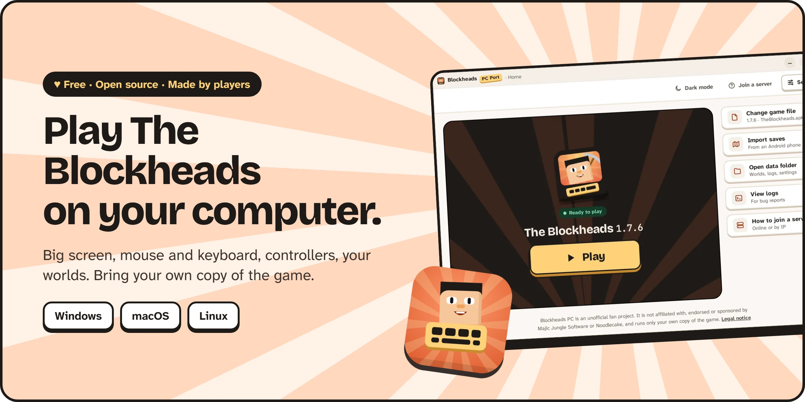
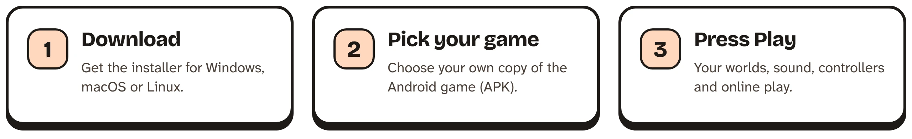
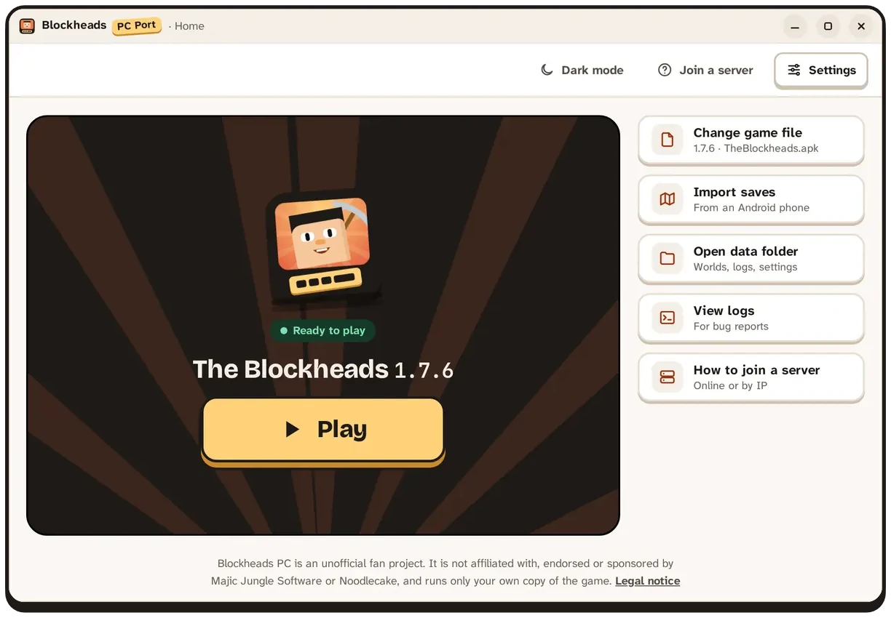
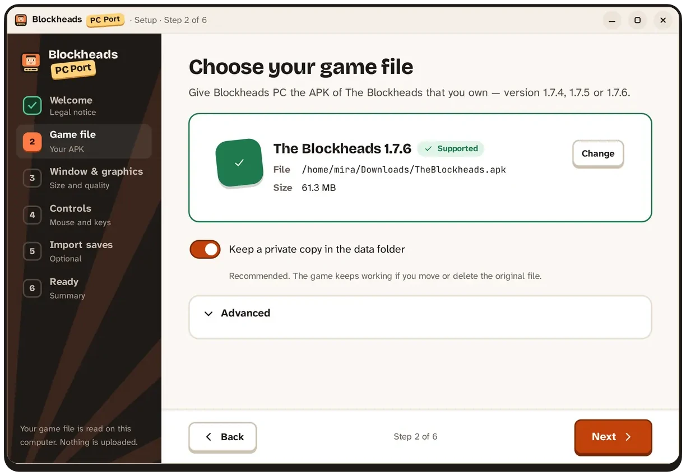
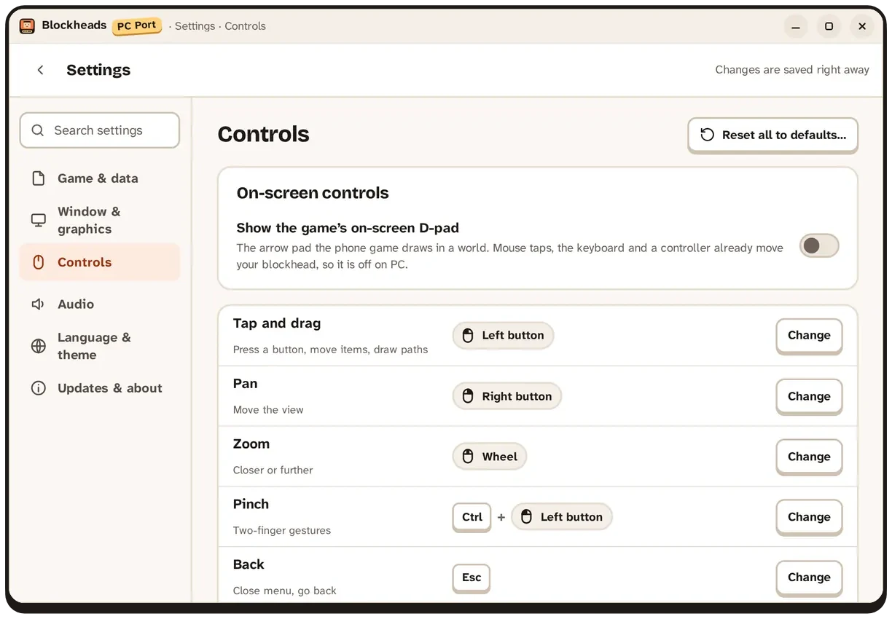
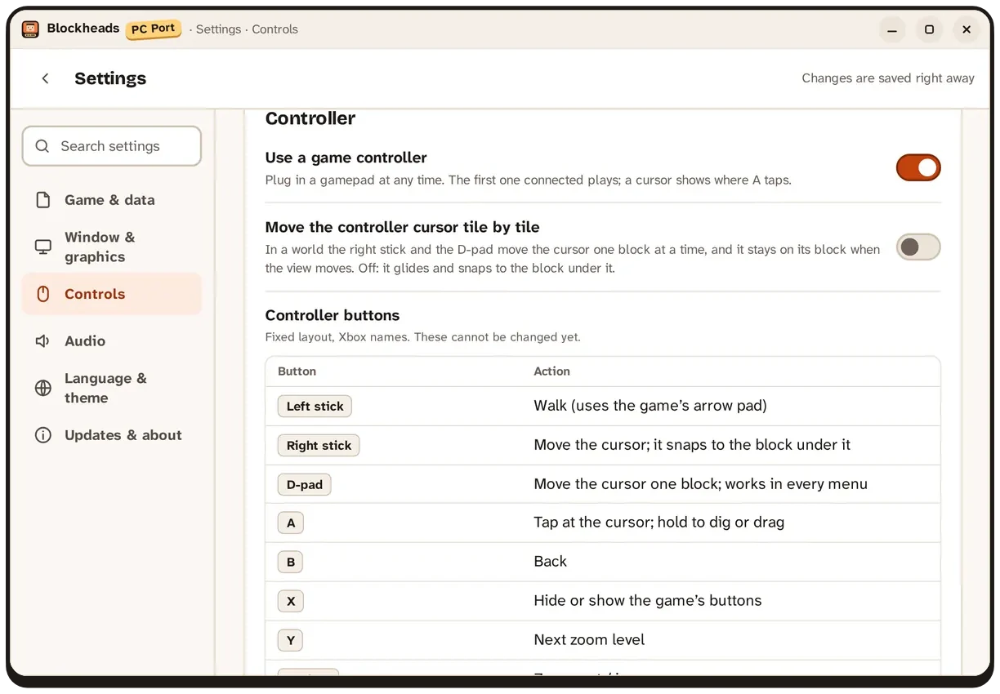

<p align="center">
  <a href="https://github.com/Blockheads-Club/blockheads-pc/releases/latest">
    
  </a>
</p>

<p align="center">
  <a href="https://github.com/Blockheads-Club/blockheads-pc/releases/latest"></a>
  <a href="https://github.com/Blockheads-Club/blockheads-pc/releases"></a>
  <a href="https://github.com/Blockheads-Club/blockheads-pc/stargazers"></a>
  <a href="LICENSE"></a>
</p>

<h3 align="center">
  <a href="https://github.com/Blockheads-Club/blockheads-pc/releases/latest">⬇️ Download</a>
  &nbsp;·&nbsp;
  <a href="https://blockheads.club/docs/pc-port">📖 Guide</a>
  &nbsp;·&nbsp;
  <a href="https://blockheads.club/docs/faq">❓ FAQ</a>
  &nbsp;·&nbsp;
  <a href="https://github.com/Blockheads-Club/blockheads-pc/issues/new">🐞 Report a bug</a>
</h3>

<br>

The Blockheads was made for phones. **Blockheads PC** brings it to your desktop: a big window or fullscreen, mouse and
keyboard, your game controller, your worlds. It runs **your own copy** of the Android game, so nothing is included
and nothing is downloaded.

> [!NOTE]
> **Alpha (v0.5.1 pre-release).** The game starts, worlds load, sound plays and online servers work. Expect a few rough
> edges, and please [tell us what you find](https://github.com/Blockheads-Club/blockheads-pc/issues).

## ✨ What you get

<table>
  <tr>
    <td width="50%" valign="top">
      <h3>🖥️ Big screen, crisp picture</h3>
      Play in a window of any size or in fullscreen (<kbd>F11</kbd>). Pick your FPS limit, VSync and game UI size.
    </td>
    <td width="50%" valign="top">
      <h3>🎮 Your way to play</h3>
      Mouse and keyboard out of the box, rebindable keys, game controllers and an on-screen D-pad.
    </td>
  </tr>
  <tr>
    <td valign="top">
      <h3>🌍 Bring your worlds</h3>
      Import your saves from an Android phone and keep playing where you stopped.
    </td>
    <td valign="top">
      <h3>🌐 Play online</h3>
      Join public servers and your friends' servers, including the ones made with
      <a href="https://github.com/Blockheads-Club/blockheads-server">Blockheads Server</a>.
    </td>
  </tr>
  <tr>
    <td valign="top">
      <h3>🧩 Mods ready</h3>
      Join modded servers: the PC client downloads the mods a server uses and asks you first.
    </td>
    <td valign="top">
      <h3>🔒 Your game, your files</h3>
      No game files in this project and no downloads from anywhere. Worlds stay on your computer.
    </td>
  </tr>
</table>

## 🚀 Start playing in 3 steps

<p align="center"></p>

<p align="center">
  <a href="https://github.com/Blockheads-Club/blockheads-pc/releases/latest"></a>
  <a href="https://github.com/Blockheads-Club/blockheads-pc/releases/latest"></a>
  <a href="https://github.com/Blockheads-Club/blockheads-pc/releases/latest"></a>
</p>

| Your computer | File to download |
| --- | --- |
| 🪟 Windows | `_x64-setup.exe` (or `_arm64-setup.exe` on ARM laptops) |
| 🍎 macOS | `_aarch64.dmg` for Apple Silicon, `_x64.dmg` for Intel Macs |
| 🐧 Linux | `.AppImage` (any distribution), `.deb` or `.rpm` |

Then start **Blockheads PC**, choose your copy of the game (The Blockheads for Android, **1.7.4 to 1.7.6**) and press
**Play**. Don't have the file yet? [Here is how to get your APK](https://blockheads.club/docs/guides/get-apk).

## 📸 Screenshots

<table>
  <tr>
    <td width="50%"></td>
    <td width="50%"></td>
  </tr>
  <tr>
    <td></td>
    <td></td>
  </tr>
</table>

## ❓ Questions

<details>
<summary><b>Is the game included? Do I need to buy it?</b></summary>
<br>
The game is not included. You need your own copy of The Blockheads for Android (the APK file). Blockheads PC only
runs that copy on your computer.
</details>

<details>
<summary><b>Windows or macOS says the app is not safe.</b></summary>
<br>

- **Windows:** the installer is not code-signed yet, so SmartScreen may warn. Click **More info**, then **Run anyway**.
- **macOS:** the app is not notarized yet. Right-click the app, choose **Open**, then **Open** again (first time only).
</details>

<details>
<summary><b>Where are my worlds?</b></summary>
<br>
Press <b>Open data folder</b> on the Home screen. Controls, saves and known issues:
<a href="docs/playing.md">docs/playing.md</a>.
</details>

<details>
<summary><b>The game stutters, freezes or closes.</b></summary>
<br>
Press <b>View logs</b> on the Home screen and attach them to a
<a href="https://github.com/Blockheads-Club/blockheads-pc/issues/new">bug report</a>, with your Blockheads PC
version and your system. More tips: <a href="https://blockheads.club/docs/pc-port#troubleshooting">troubleshooting</a>.
</details>

<details>
<summary><b>Is this official?</b></summary>
<br>
No. It is a free fan project, not affiliated with Majic Jungle or Noodlecake.
</details>

## 🧱 Part of Blockheads Club

<table>
  <tr>
    <td align="center" width="25%"><a href="https://github.com/Blockheads-Club/blockheads-patcher"><br><b>Patcher</b></a><br><sub>Fix the game on your phone</sub></td>
    <td align="center" width="25%"><a href="https://github.com/Blockheads-Club/blockheads-server"><br><b>Server</b></a><br><sub>Host worlds for friends</sub></td>
    <td align="center" width="25%"><a href="https://github.com/Blockheads-Club/world-tool"><br><b>World Tool</b></a><br><sub>Move and edit your worlds</sub></td>
    <td align="center" width="25%"><a href="https://github.com/Blockheads-Club/mod-sdk"><br><b>Mod SDK</b></a><br><sub>Make your own mods</sub></td>
  </tr>
</table>

<p align="center">All apps, guides and downloads: <a href="https://blockheads.club"><b>blockheads.club</b></a></p>

## 🛠️ For developers

<details>
<summary><b>Build from source</b></summary>
<br>

You need Rust stable (1.86+), CMake 3.16+, a C++20 compiler, Boost headers, SDL2, and [bun](https://bun.sh) for the
launcher.

```bash
git clone https://github.com/Blockheads-Club/blockheads-pc.git
cd blockheads-pc
cargo build --release -p bhpc-run --features play
./target/release/bhpc-run --apk "/path/to/The Blockheads.apk"
```

Before a pull request run `scripts/check-fast.sh` (every change keeps 100% test coverage). More:

- [docs/development.md](docs/development.md): how it works, build, run options, tests and coverage
- [docs/launcher.md](docs/launcher.md): the launcher app (`app/`)
- [docs/feasibility/PLAN.md](docs/feasibility/PLAN.md): architecture and milestones
</details>

Everyone can open [issues](https://github.com/Blockheads-Club/blockheads-pc/issues) and pull requests. Irrelevant or
abusive issues may be closed or removed.

## 📄 License

Blockheads PC is free software under the **GNU GPLv3 or later** (GPL-3.0-or-later): you can redistribute it and/or
modify it under the terms of the GNU General Public License as published by the Free Software Foundation, either
version 3 of the License, or (at your option) any later version. See [LICENSE](LICENSE).

Unofficial fan project, not affiliated with Majic Jungle or Noodlecake. "The Blockheads" belongs to its owners; this
repository contains no game code or assets.
