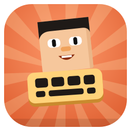

<p align="center">
  
</p>

<h1 align="center">Blockheads PC</h1>

<p align="center">
  Play <b>The Blockheads</b> on your computer — Windows, macOS and Linux. Use your own copy of the game. 🎮
</p>

<p align="center">
  
  <a href="https://github.com/Blockheads-Club/blockheads-pc/releases"></a>
  <a href="https://github.com/Blockheads-Club/blockheads-pc/actions/workflows/ci.yml"></a>
  <a href="LICENSE"></a>
</p>

---

## 🚀 Project Status
**Current Status:** Alpha (v0.5.0 pre-release). The game starts, you can create and load worlds, play with mouse,
keyboard or a controller, hear the sound and join online servers. Expect rough edges and
[report what you find](https://github.com/Blockheads-Club/blockheads-pc/issues).

Blockheads PC runs the Android version of the game (1.7.4, 1.7.5 or 1.7.6) on your computer. **No game files are
included and nothing is downloaded:** on first start the launcher asks for your own copy of the game (APK file).

---

## 📦 Other Blockheads Club Repositories
- [**blockheads-patcher**](https://github.com/Blockheads-Club/blockheads-patcher) - Fix crashes and add small improvements to the game on your phone
- [**blockheads-server**](https://github.com/Blockheads-Club/blockheads-server) - Host your own Blockheads server for friends
- [**website**](https://github.com/Blockheads-Club/website) - The [Blockheads Club website](https://blockheads-club.github.io/website/): downloads, guides and docs

---

## ⚡ Trying Blockheads PC
Download the installer for your system from the [latest release](https://github.com/Blockheads-Club/blockheads-pc/releases/latest):

| System | File |
|---|---|
| Windows | `_x64-setup.exe` (or `_arm64-setup.exe`) |
| macOS | `_aarch64.dmg` (Apple Silicon) or `_x64.dmg` (Intel) |
| Linux | `.AppImage`, `.deb` or `.rpm` |

Start **Blockheads PC**, pick your copy of the game and press Play.

- **Windows:** the installer is not code-signed, so SmartScreen may warn: "More info" -> "Run anyway".
- **macOS:** the app is not notarized: right-click it -> Open the first time.

Controls, saves and known issues: [docs/playing.md](docs/playing.md). Guides and docs:
[blockheads-club.github.io/website/docs](https://blockheads-club.github.io/website/docs/).

---

## 🛠️ Requirements
**To play:** a 64-bit Windows, macOS or Linux computer (x86_64 or arm64) with OpenGL, and your own copy of
The Blockheads for Android (1.7.4 to 1.7.6).

**For contributors / development:** Rust stable (1.86+), CMake 3.16+, a C++20 compiler, Boost headers, SDL2, and
[bun](https://bun.sh) for the launcher.

---

## 🤝 Contributing
Everyone can open [issues](https://github.com/Blockheads-Club/blockheads-pc/issues) and pull requests. Irrelevant or
abusive issues may be closed or removed.

### Development Guide
```bash
git clone https://github.com/Blockheads-Club/blockheads-pc.git
cd blockheads-pc
cargo build --release -p bhpc-run --features play
./target/release/bhpc-run --apk "/path/to/The Blockheads.apk"
```

Before a pull request run `scripts/check-fast.sh` (every change keeps 100% test coverage). More:
- [docs/development.md](docs/development.md) - how it works, build, run options, tests and coverage
- [docs/launcher.md](docs/launcher.md) - the launcher app (`app/`)
- [docs/feasibility/PLAN.md](docs/feasibility/PLAN.md) - architecture and milestones

---

## 📄 License
Blockheads PC is licensed under **GNU GPLv3 or later** (GPL-3.0-or-later). This program is free software: you can redistribute it and/or modify it under the terms of the GNU General Public License as published by the Free Software Foundation, either version 3 of the License, or (at your option) any later version. See the [LICENSE](LICENSE) file for details.

Unofficial fan project, not affiliated with Majic Jungle or Noodlecake. "The Blockheads" belongs to its owners;
the repository contains no game code or assets.
